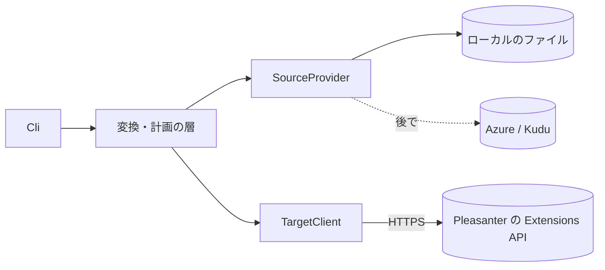

# アーキテクチャ方針

状態: 設計の段階。コードは雛形（Pleasanter API クライアントの最小実装と接続確認の CLI）のままで、
このツールの機能は未実装。進み具合は GitHub の親 Issue を見ること。

## 位置づけ

Pleasanter のパラメーターをファイルで管理する拡張機能（`ExtendedScripts` など）を、Extensions テーブルへ移す CLI。
Pleasanter 本体のコード・アセンブリは取り込まない（派生著作物にしない。[ライセンス](ライセンス.md)）。
Pleasanter とは標準の Web API（`api/extensions/*`）と、設定ファイル置き場のファイル操作だけで関わる。

## 事実確認の結果（Pleasanter 1.5.9.1）

確認した参照ソース: Implem.Pleasanter `1.5.9.1`、完全な SHA `664c833b144d9da9b6bb58e60f7e48eb01141e58`、参照日 2026-11-02
（`bash scripts/sync-reference.sh` で取得して読んだ。**読んだだけで、実機では確認していない**）。
稼働中のビルドが同じコミットかどうかは断定しない。対応版を増やすときは、同じ規則が成り立つか比べる。

| 事実 | 根拠（SHA 固定） |
| --- | --- |
| Extensions を読み込むとき、無効でないレコードを `ExtensionName` 順に取り、種類（`Fields`・`Html`・`NavigationMenu`・`Script`・`ServerScript`・`Sql`・`Style`・`Plugin`）ごとに設定を復元する。名前は `ExtensionName` が空でなければそれを、空なら設定内の名前を使う。`Body` が空でなければ本文として優先する。**`Tenant` で絞り込まない** | [ExtensionInitializer.cs L13-L155][ext-init] |
| ファイル側の SQL・サーバースクリプトは、`<定義>.json` と同じ場所に `<定義>.json.sql` / `<定義>.json.js` があれば、その内容が本文になる（JSON 内の本文より優先）。判定は存在の有無で、内容が空でもフォールバックしない | [Initializer.cs L758-L819][file-rules] |
| ファイル側は階層を再帰して読む。JS・CSS・HTML・SQL・サーバースクリプト・ナビゲーションメニューの読み方はそれぞれ別（HTML は空のファイルを読み込まない） | [Initializer.cs L652-L881][file-rules-all] |
| Extensions API の `Get` / `Create` / `Update` / `Delete` は `api/extensions` の下にあり、テナントの許可（`AllowExtensionsApi`）と特権ユーザーが要る | [ExtensionsController.cs][ext-api] |
| API モデルの既定値: `ExtensionType`・`ExtensionName`・`Body` は空文字、`Disabled` は `false`。`SetByApi` はこれらを更新へ反映する。**`Disabled` だけを送って有効・無効を切り替えてはいけない** | [ExtensionApiModel.cs L14-L28][api-model]、[ExtensionModel.cs L568-L579][set-by-api] |
| `Comments` は上書きではなく先頭への追記になる | [ExtensionModel.cs L568-L579][set-by-api] |
| パラメーターの再読込は特権ユーザーの権限が要り、ファイルの再読込のあとに Extensions の初期化が続く | [ParametersInitializer.cs][params-init] |

[ext-init]: https://github.com/Implem/Implem.Pleasanter/blob/664c833b144d9da9b6bb58e60f7e48eb01141e58/Implem.Pleasanter/Libraries/Initializers/ExtensionInitializer.cs#L13-L155
[file-rules]: https://github.com/Implem/Implem.Pleasanter/blob/664c833b144d9da9b6bb58e60f7e48eb01141e58/Implem.DefinitionAccessor/Initializer.cs#L758-L819
[file-rules-all]: https://github.com/Implem/Implem.Pleasanter/blob/664c833b144d9da9b6bb58e60f7e48eb01141e58/Implem.DefinitionAccessor/Initializer.cs#L652-L881
[ext-api]: https://github.com/Implem/Implem.Pleasanter/blob/664c833b144d9da9b6bb58e60f7e48eb01141e58/Implem.Pleasanter/Controllers/Api/ExtensionsController.cs
[api-model]: https://github.com/Implem/Implem.Pleasanter/blob/664c833b144d9da9b6bb58e60f7e48eb01141e58/Implem.Pleasanter/Models/Extensions/ExtensionApiModel.cs#L14-L28
[set-by-api]: https://github.com/Implem/Implem.Pleasanter/blob/664c833b144d9da9b6bb58e60f7e48eb01141e58/Implem.Pleasanter/Models/Extensions/ExtensionModel.cs#L568-L579
[params-init]: https://github.com/Implem/Implem.Pleasanter/blob/664c833b144d9da9b6bb58e60f7e48eb01141e58/Implem.Pleasanter/Libraries/Initializers/ParametersInitializer.cs#L7-L15

## 変換の規則（実装済み。1.5.9.1 のソースの読みに基づく。実機は未確認）

| 種類 | 名前 | 本文 | 設定（`ExtensionSettings`） |
| --- | --- | --- | --- |
| Script・Style | 拡張子込みのファイル名 | ファイル全文 | `{}` |
| Html | ファイル名の最後の `_` 以降を言語、それより前を挿入位置（名前）とする | ファイル全文（空のファイルは Pleasanter が読み込まないので保持） | 言語があれば `{"Language":"…"}`、無ければ `{}` |
| Sql・ServerScript | 定義 JSON の `Name`（無ければ空のまま） | 併設ファイル（`.json.sql`・`.json.js`）があれば空でもそれ、無ければ JSON の `CommandText`・`Body` | 定義 JSON から本文のキーだけを除き、他は保つ（キー順のみ整える） |
| NavigationMenu | 定義 JSON の `Name` | なし | 定義 JSON そのまま |

元の `Disabled` と `Description` は、API の項目にも写す（設定内にも残す）。JSON の読みは、コメントと末尾のカンマを許す（Pleasanter 側の読み方は未確認）。
`Fields`・`Plugin` の場所は、変換せず保持（`type-not-verified`）にする。それ以外の `Extended*` で対応する種類が無いものは `no-extensions-type`。

## 構成（案）

- **SourceProvider**: 実ルートの特定、再帰一覧、読み取り、版・ハッシュの取得、元バイト列のバックアップ、条件付きの退避・削除、
  探索範囲外への保管と復元。最初はローカルのファイル。Azure（Kudu）は別の provider として後から足し、変換の層へホストや認証トークンを渡さない
- **TargetClient**: Extensions API の `Get` / `Create` / `Update` / `Delete` と、対象・権限・対応版の確認。API キーは保存しない。
  HTTPS 以外・別ホストへのリダイレクト・秘密を含むエラー本文の扱いを決める
- **変換・計画の層**: 種類ごとの本文と名前の決め方、分類、識別（sourceKey→ExtensionId）、plan の生成。ネットワークとファイルへの書き込みを持たない
- **journal（台帳）**: 各操作の意図（`IntentRecorded`）・応答（`ResponseConfirmed`）・結果不明（`OutcomeUnknown`）・照合（`Reconciled`）を、
  操作の前に永続化する。更新は一時ファイル＋原子的な置換

## 決めたこと

- **終了コードは既存の PleasanterTools と同じ。** 成功 0、失敗・指摘あり 1、引数・設定の誤りと未実装 2。引数の誤り（未知のオプション・重複・値の欠落）は黙って無視せず 2 で終わる。
  コンソールの出力は英語。API キーは環境変数（`PLEASANTER_API_KEY`）から読み、`ToString` や出力に出さない
- **最初の提供形態は CLI。** `inventory`・`validate`・`plan` は何も書かない（出力先のファイルだけ）。変更を伴うコマンドは plan の ID・ハッシュと journal を指定する
- **通常の処理は DB へ直接接続しない。** SQL Server 固有の SQL に依存しない。SQL Server 以外は、実機で確認した範囲を分けて対応表に載せる
- **本文は存在すれば併設を優先する**（上の表の規則に合わせる）。インラインのプレースホルダー検出に依存しない
- **名前を変えない。名前は一意キーにしない。** 空名・同名がありうる。sourceKey（ソースの識別子とルートからの相対パス）と ExtensionId の対応を台帳に持つ。`Comments` は識別子に使わない
- **API 更新は許可リスト方式。** 種類・名前・設定・本文・Description・Disabled を、照合済みのデータから送る。`Get` の返却をそのまま `Update` に送り返さない
- **結果不明の操作を推測で成功・失敗に寄せない。** 再開時に現在のファイルと API のレコードを照合し、一意に決まらなければ止まる
- **移行後の元ファイル不在は正常。** ファイルが無いことを理由に DB のレコードを消さない
- **`Fields`・`Plugin` は、実装と専用の fixture で確認するまで、自動切替の対応済みとして出さない。**
  `ExtendedColumns` などの別の仕組みを、対応する拡張の種類へ勝手に置き換えない
- **特定の環境のフォルダ名・接頭辞を既定の除外にしない。** 除外・保持・生成物の置換は利用者が設定する。生成物の作成そのものは移行の処理に結合しない
- **API キー・Cookie・認証トークンを、引数の履歴・設定ファイル・plan・journal・ログに残さない。** 環境変数などの秘密の参照から読む。API の要求・応答の全文をログに出さない
- **fixture とテストは合成データだけ。** 実環境の拡張の本文・名称・件数を使わない
- **依存は寛容ライセンスのみ。** 最初は新しい依存を足さない（下の未決定を参照）

## 未決定

選択肢と推奨を書く。決まるまでは勝手に進めない。各項目は Issue で扱う。

| 項目 | 選択肢 | 推奨 |
| --- | --- | --- |
| 共通部品 Core を使うか | A. 使わず最小の依存で始める / B. Core.Data・Core.Web 等を参照する | A。Core 系を依存に足すと、`LICENSING.md`・`LICENSE-COMMERCIAL.md` の `core` の節の ID を変える必要がある。足りない部品があれば法務確認が要る。本ツールは DB を使わず、必要になった共通部分が出てから再検討する |
| コマンドの解析 | A. 手書きの最小の解析 / B. System.CommandLine など（MIT） | 当面 A（骨組みは A で実装済み。未確定のまま進めている）。コマンド数が少ない間は依存を増やさない。サブコマンドとオプションが増えたら B を再検討 |
| plan・journal の形式と `formatVersion` | JSON（スキーマを文書化）/ その他 | JSON。インデントと順序を固定し、規則の版・ツールの版を含める（棚卸し結果は `formatVersion` 1 で実装済み。plan・journal は未実装） |
| ハッシュの種類 | 元バイト列・BOM を除いたデコード本文・設定 JSON の意味上のハッシュを別々に持つ。改行の正規化の有無 | 3 種を別に記録する。改行は正規化しない（元バイトのバックアップは必ず保つ）。棚卸しで実装済み（キー順は序数順に整え、配列の順は変えない） |
| 除外・保持・置換の設定の形式 | JSON の設定ファイル / コマンドラインのオプション | JSON の設定ファイル（秘密は含めない）。棚卸しで実装済み（`--rules`。オプションでの上書きは未実装） |
| 無人実行の許可の方法 | 既存のツールは `--dry-run`・`--yes` の確認フラグ（BinaryMigrator） / 環境変数 | 変更を伴うコマンド（子 4 以降）を実装する前に決める。`--yes` に合わせるのが推奨 |
| テナント | 対象テナントの確認と、`TenantId` を既定にするか指定するか | 指定を必須にして、既存レコードの値を維持する。確認版の初期化は `TenantId` で絞らないため、適用範囲の隔離境界にしない |
| 再反映の方法 | 手動 / 通常ログインの Cookie で自動 | 最初は手動（`AwaitingReload`）。自動は認証・CSRF・SSO・二要素・サブディレクトリの扱いを決めてから。非特権ユーザーでも空応答になり得るので、HTTP 200 と空本文を成功の証明にしない |
| Azure（Kudu）の認証と SDK | Entra 認証（Azure.Identity など MIT）/ 他 | provider を足す段階で決める。変換の層と分離する |
| NuGet（dotnet tool）での配布 | する / しない | 将来する。ライセンス表示（`PackageLicenseFile`）と Trusted Publishing、SNI.runtime の有無を、その時に確認する |
| 実機検証の環境 | Docker の Pleasanter（検証専用）/ 他 | 検証専用の環境だけで行う。実環境には接続しない。未検証の機能は未検証と書く |

## 参照

- 実機の Pleasanter に対する動作確認は**まだ行っていない**
- 取得した参照ソースは Git で追跡せず、ビルド・配布物へ含めない（[参照ソース](../_reference/README.md)）
