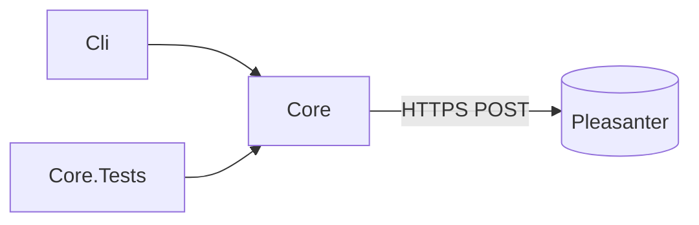

# アーキテクチャ方針

## 位置づけ

Pleasanter の標準 Web API を叩く別アプリを作るための土台です。Pleasanter 本体のコードは取り込みません。派生著作物にしないことで、ライセンスの選択肢（[ライセンス](ライセンス.md)）を残します。

## 構成

- `Core`: Pleasanter API クライアントと接続設定。UI や実行形態に依存しない
- `Cli`: 接続確認の CLI。ツール固有の処理はここか、新しいプロジェクトへ足す
- `Core.Tests`: クライアントの単体テスト。通信はスタブで差し替える

## 決めたこと

- **API キーはリクエストボディに載せる。** `Context.cs` がリクエストの `ApiKey` を読むことを確認した。
  根拠は [Context.cs][api-key-source]（SHA `1c693a1ee379a87e588232e43216400431376653`、
  参照日 2026-10-26）。キーをブラウザへ渡さず、サーバ側だけが持つ設計にする
- **クライアントは再試行しない。** 応答を `PleasanterErrorKind` で分類して返し、再送するかは呼び出し側が決める。応答が返らなかった場合（`Unknown`）は、できたかどうか分からないため照合してから判断する
- **ランタイムは Pleasanter 本体に揃える。** .NET 10 / net10.0
- **依存は寛容ライセンスに限る。** デュアルライセンス（AGPL ＋ 商用）の商用側を提供できる状態を保つため
- **本体ソースは AI の参照専用で、必要時に取得する。** CI は使わない。
  `bash scripts/sync-reference.sh` で上流 `main` の先頭へ更新してから読む。
  Git のポインタは追跡せず、文書に確認した SHA・固定リンク・参照日を記録して再現性を保つ。
  日次追従や更新 PR、bot の迂回権限は不要（[参照ソース](../_reference/README.md)）
- **Manual・Overview の参照も必要時取得へ統一する。** 2026-10-26 決定（Issue #63）。
  各アプリは一覧なしの本体 1 件、Manual・Overview は `references.json` の各 branch を取得する。
  private の取得は実行者本人の認証に依存し、取得できなければ未確認とする。
  Template に実例と配布手順を置くが、他リポジトリへの反映は別の Issue / PR で行う

## 未決定

- `ApiVersion` の既定値 `1.1` は上流ソースで再確認していない。
  ツールを作るときに取得スクリプトを実行して確認し、SHA・固定リンク・参照日を残す
- 実機の Pleasanter に対する動作確認は行っていない（単体テストはスタブのみ）

[api-key-source]: https://github.com/Implem/Implem.Pleasanter/blob/1c693a1ee379a87e588232e43216400431376653/Implem.Pleasanter/Libraries/Requests/Context.cs#L497-L504
